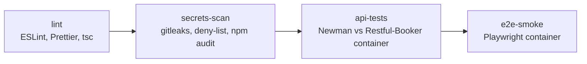

# QA Automation Portfolio

[](https://github.com/florent-griffon-qa/qa-portfolio/actions/workflows/ci.yml)

API and UI test automation on public demo applications, built the way I work on real projects:
measured behaviour before assertions, observed DOM before locators, pinned versions, and a CI
pipeline that guards secrets as well as quality.

| Layer    | Target                                                                                                          | Tooling                                       |
| -------- | --------------------------------------------------------------------------------------------------------------- | --------------------------------------------- |
| API      | [Restful-Booker](https://restful-booker.herokuapp.com/apidoc/index.html) (public instance + local Docker image) | Postman, Newman, htmlextra                    |
| UI       | [SauceDemo](https://www.saucedemo.com)                                                                          | Playwright, TypeScript, Page Objects          |
| Pipeline | GitHub Actions                                                                                                  | lint, secrets scan, API tests, UI smoke tests |

## Quick start

Prerequisites: Docker. For local runs without Docker: Node.js 24.21.0 (see `.nvmrc`).

```bash
git clone https://github.com/florent-griffon-qa/qa-portfolio.git
cd qa-portfolio
npm ci

# API tests in Docker, against a local Restful-Booker container
docker compose -f docker/docker-compose.yml run --rm api-tests

# UI smoke tests in Docker (chromium + firefox)
docker compose -f docker/docker-compose.yml run --rm e2e-tests

docker compose -f docker/docker-compose.yml down
```

Reports are written to `reports/` (HTML and JUnit XML). Without Docker:

```bash
npm run test:api:public        # API tests against the public instance
npx playwright install         # once, to download the browsers
npm run test:smoke             # UI smoke tests
npm run test:e2e:report        # open the Playwright HTML report
```

A `Makefile` wraps the same commands (`make help`).

## What is inside

```text
postman/      Restful-Booker collection, environments (local, public), Newman runner
playwright/   config, test data per environment, fixtures, Page Objects, smoke specs
docs/         API documentation analysis, bug reports
scripts/      deny-list scan, gitleaks wrapper
docker/       test runner image, compose stack
.github/      CI pipeline
```

## Test design

### API (Postman / Newman)

- Two folders, `Positive` and `Negative`. Each one creates its own booking, works on it and
  deletes it: no test depends on pre-existing data, which matters on a public instance that is
  reset and shared.
- Every Test Results line starts with the environment and the request name, so a failure can be
  traced without opening the report.
- The API behaviour was measured before any assertion was written. The differences with the
  documentation are analysed in [`docs/API_DOC_ANALYSIS.md`](docs/API_DOC_ANALYSIS.md), with a
  classification rule (defect, design observation, documentation gap).
- Known defects are covered by characterization tests: they assert the current behaviour, carry
  the bug id in their name, and fail with an actionable message the day the API is fixed. See
  the [Known defects policy](postman/README.md#known-defects-policy) and [`docs/bugs/`](docs/bugs/).

### UI (Playwright)

- Page Objects built from the observed DOM, each with a header that records when and how it was
  validated, the DOM structure, its use cases and its invariants.
- Every user action is a named `test.step()` followed by an assertion.
- Prices are compared in integer cents: subtotal, tax and total are recomputed, not just read.
- Timeouts and retries are set in one place, `playwright/playwright.config.ts`.

## CI pipeline



- The UI job runs in the same Playwright image (pinned by digest) as `docker/Dockerfile`, so CI
  and local runs give the same results.
- Reports (Newman HTML and JUnit, Playwright HTML and JUnit, full `npm audit`) are uploaded as
  workflow artifacts.
- `npm audit --audit-level=critical` blocks the pipeline; the full report is informational.

## Security guards

- gitleaks runs on staged changes before each commit and on the full history in CI.
- A deny-list scan blocks any commit that contains a forbidden term (files, file paths, commit
  message), and fails the pipeline if one appears anywhere in the Git history. The list itself is never committed: it lives in an
  ignored local file and in a CI secret, and the scan fails if the list is missing. Before each
  run, the scan plants a random canary term and checks it finds it, so a broken scanner cannot
  report a false green.
- Every version is pinned: npm packages (exact), Docker images (digest), GitHub Actions (commit SHA).

## How I work with AI

I define the intent and the acceptance criteria, an AI assistant generates the code, I review
every change, and the CI pipeline validates it. Rules for the assistant live in
[`CLAUDE.md`](CLAUDE.md). A detailed write-up of the workflow is planned for the next version.

## Known limitations

- Both targets are public services I do not control. They can be slow, unavailable, or reset
  (Restful-Booker is reset regularly). CI retries UI tests up to 2 times; locally there is no retry.
- SauceDemo has no local instance: the `local` and `public` environments are identical for UI tests.
- SauceDemo is English-only, so the bilingual (EN/FR) assertion pattern cannot be demonstrated on it.
- Five npm advisories remain in the Newman toolchain (none critical): they have no fix within the
  same major version. Details in [Dependency overrides](postman/README.md#dependency-overrides).
- Pull requests from forks fail the deny-list step: the CI secret is not available to them.

## Roadmap

- V2: test strategy, traceability, test case management, AI workflow write-up.
- V3: hybrid API + UI tests on a self-hosted application, nightly runs, published reports.
- V4: mobile tests with Appium.

## Author

Florent Griffon, QA Engineer. [LinkedIn](https://www.linkedin.com/in/thoflorent-griffon)

## License

[MIT](LICENSE)
