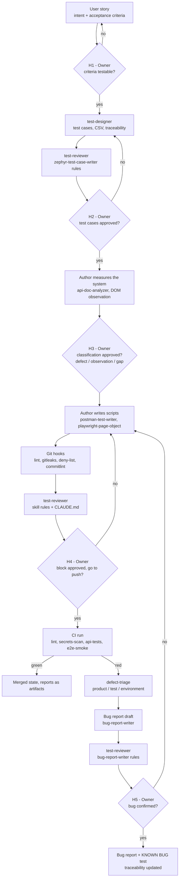

# AI workflow

How this repository is built with an AI coding assistant, and where a human decides.

The short version: I define the test intent, the acceptance criteria and the rules; the AI
generates; a separate reviewer agent checks the output against the rules; I approve; CI validates.
Nothing reaches GitHub without my explicit go.

## Roles

| Role              | Who                                                      | Responsibility                                                                                                                                                 | Never does                                          |
| ----------------- | -------------------------------------------------------- | -------------------------------------------------------------------------------------------------------------------------------------------------------------- | --------------------------------------------------- |
| Owner             | Me (QA engineer)                                         | Defines test intent, acceptance criteria and rules (`CLAUDE.md`, skills). Approves every block, every classification, every push and every irreversible action | Delegates a go/no-go decision                       |
| Author            | AI assistant, with the skills in `.claude/skills/`       | Measures the system, generates test cases, scripts, Page Objects, bug reports; runs them and shows real results                                                | Pushes, deletes, or changes visibility without a go |
| Test designer     | Agent `.claude/agents/test-designer.md`                  | Turns a story into test cases, CSV rows and traceability rows                                                                                                  | Writes automated tests                              |
| Reviewer (4-eyes) | Agent `.claude/agents/test-reviewer.md`, read-only tools | Checks an artifact against its skill and reports BLOCKING / MAJOR / MINOR findings                                                                             | Fixes anything, or reviews its own output           |
| Defect triage     | Agent `.claude/agents/defect-triage.md`                  | Classifies the failures of a red run and drafts bug reports                                                                                                    | Edits tests                                         |
| Gatekeeper        | Git hooks and GitHub Actions                             | Lint, types, secrets, deny-list, audit, API and UI suites                                                                                                      | Lets a failure through: every check fails closed    |

## Pipeline and human validation points

| Point | Who decides | What is checked                                                                                                      |
| ----- | ----------- | -------------------------------------------------------------------------------------------------------------------- |
| H1    | Owner       | Each acceptance criterion is observable and testable                                                                 |
| H2    | Owner       | Every criterion is covered; expected results are precise; known defects state the correct behaviour first            |
| H3    | Owner       | The classification rule was applied to each measured difference, with reasoning for borderline cases                 |
| H4    | Owner       | Real run results shown (not "should pass"), reviewer findings handled, scans green; then an explicit go for the push |
| H5    | Owner       | The failure was reproduced; it is a product defect, not a test or environment issue                                  |

Before any push, the release gate is a reviewer verdict without blocking findings plus the
owner's explicit go.

## Worked example: BUG-001

From a measurement to a covered, traced defect, with the files involved at each step.

1. Measure before asserting. `POST /auth` was called with a valid username and a wrong
   password, on the public instance and on the local Docker image. Both returned `200 OK` with
   `{"reason":"Bad credentials"}` and no token.
   Recorded in [API_DOC_ANALYSIS.md](API_DOC_ANALYSIS.md#summary).
2. Read the documentation. The CreateToken entry documents only a `200 OK` success; no error
   response is documented at all ([D-001](API_DOC_ANALYSIS.md#d-001---no-error-response-is-documented)).
3. Classify ([classification rule](API_DOC_ANALYSIS.md#classification-rule)). The behaviour does not
   contradict the documentation, which is silent, but it violates HTTP semantics (RFC 9110, 401
   Unauthorized) on a request that creates a session token, and it can mislead a client: a client
   that checks only the status code treats a failed login as a success. Classified as a defect,
   severity Major. Owner decision (H3).
4. Choose how to test it. The AI proposed a characterization test; the owner approved it with
   three additions: an actionable failure message, the whole defective response frozen (not only
   the status), and the bug reports written in the same module rather than later.
   Policy: [Known defects policy](../postman/README.md#known-defects-policy).
5. Write the test. Request `N03 CreateToken with bad credentials` in the
   [collection](../postman/collections/restful-booker.postman_collection.json): its pre-request
   script sets `expectedStatus` 200, `knownBug` BUG-001, `correctStatus` 401. Test Results:
   - `T01 KNOWN BUG BUG-001 - returns 200 instead of 401`
   - `T02 KNOWN BUG BUG-001 - body reason is "Bad credentials" and no token`
6. Prove the test can fail. The frozen status was changed on purpose in a throwaway copy: the
   run failed with `BUG-001 may be fixed: expected current behaviour 401, got 200 - update the
test and close the bug`. A test that cannot fail proves nothing.
7. Report it. [BUG-001](bugs/BUG-001-auth-bad-credentials-returns-200.md): steps, expected with
   its RFC reference, actual, measured evidence, covering test.
8. Trace it. Story [US-002](../test-management/stories/US-002-update-booking-auth.md),
   acceptance criterion 1; test case [QAP-T8](../test-management/test-cases/US-002.md#qap-t8---refuse-a-token-for-bad-credentials),
   whose expected result is the correct behaviour (401) followed by the current one; row in
   [TRACEABILITY.md](TRACEABILITY.md#reverse-view-defects-and-observations).
9. Keep it running. N03 runs in CI on every push, against a Restful-Booker container. The day the
   API is fixed, the pipeline turns red with the message above.

## Guardrails

| Guardrail             | Where                                          | What it stops                                                                                                                                            |
| --------------------- | ---------------------------------------------- | -------------------------------------------------------------------------------------------------------------------------------------------------------- |
| Pre-commit hook       | `.husky/pre-commit`                            | Lint or type errors, unformatted files, staged secrets (gitleaks), deny-listed terms in files                                                            |
| Commit-msg hook       | `.husky/commit-msg`                            | Non-conventional messages, deny-listed terms in the message                                                                                              |
| gitleaks              | pre-commit (staged) and CI (full history)      | Credentials and tokens committed by mistake                                                                                                              |
| Deny-list scan        | `scripts/denylist-scan.mjs`, pre-commit and CI | Forbidden terms in files, paths, commit messages and the full history                                                                                    |
| Deny-list self-test   | same script, before every run                  | A broken scanner reporting a false green: a random canary is planted and must be found, a negative control must not match, and no canary file may remain |
| Fail closed           | same script, gitleaks wrapper, Newman runner   | A missing list, a missing tool, or a run with zero assertions is a failure, never a pass                                                                 |
| Secret handling in CI | `DENYLIST_B64`, scoped to the scan steps       | Partial log masking that would hint at the list (see below)                                                                                              |
| `npm audit`           | CI                                             | Critical vulnerabilities in the toolchain                                                                                                                |
| Pinned versions       | `package.json`, Docker digests, Actions SHAs   | Silent drift between local and CI runs                                                                                                                   |
| `CLAUDE.md` rule 13   | assistant instructions                         | Destructive Git commands in the working repo; negative tests that need them run in a throwaway clone                                                     |
| `CLAUDE.md` rule 14   | assistant instructions                         | A push from the wrong account or with the wrong commit email                                                                                             |
| `CLAUDE.md` rule 15   | assistant instructions                         | Any irreversible action (delete, visibility change, secret removal) without first showing its impact and getting a go                                    |

## What the guardrails caught while building this repository

Each of these was found by running a check, not by reading code, and fixed in its own commit:

- The deny-list self-test left its canary file behind when it failed (`process.exit` skipped the
  cleanup). Fixed, then a final "no canary left" check was added.
- The first commit was made before the Git hooks were installed. Checks were re-run by hand on that
  commit, and the hooks were verified on the next ones.
- A destructive Git command used during a negative test wiped an uncommitted change. Restored and
  re-tested; this is why rule 13 exists.
- The first CI run showed that GitHub masks a multi-line secret line by line, even inside other
  words: masked fragments hinted at deny-listed terms. The list is now passed as one base64 line,
  the old runs were deleted.
- Old workflow runs were deleted before their list was shown to the owner. No harm, but the
  process was wrong; this is why rule 15 exists.
- The end-of-script log of every Postman request printed the authentication token. It now redacts
  it, checked on real runs (local and public).

## Known limitations

- Agent path restrictions are prompt-level only. `tools:` limits which tools an agent can use,
  not which paths it can write: "test-designer writes only under `test-management/`" and
  "defect-triage never edits tests" are instructions, not enforced controls. Only `test-reviewer`
  is technically read-only.
- Reviewer independence is procedural: `test-reviewer` refuses to review its own output when the
  brief says so, but nothing technical prevents a misleading brief.
- The Zephyr Scale import format (multi-step grouping, custom `Automated` status) is to be
  confirmed at the first real import; see [test-management/README.md](../test-management/README.md).
- The Newman HTML report stores full responses, including the demo authentication token of the
  public Restful-Booker instance. It is a public demo credential with no value outside it, but the
  report artifacts should be treated like logs.
